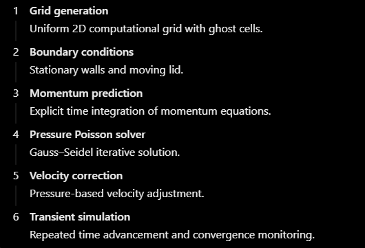
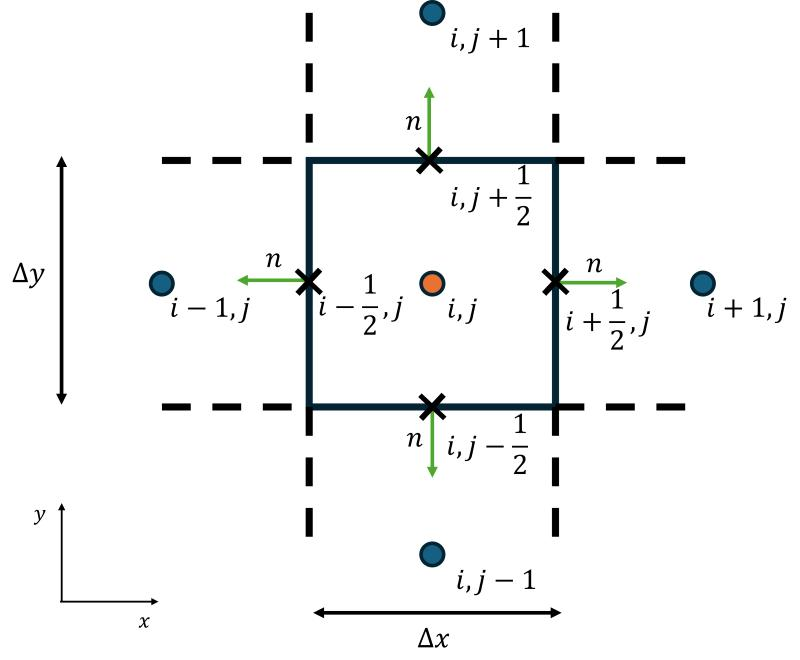
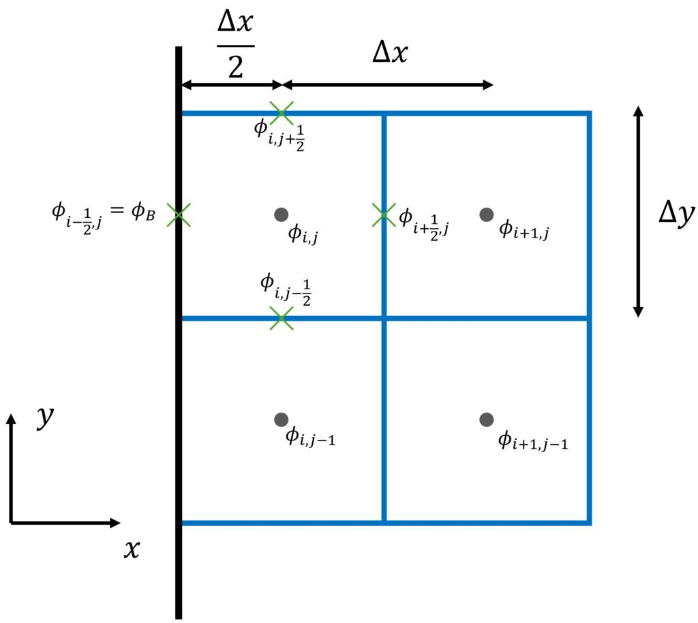
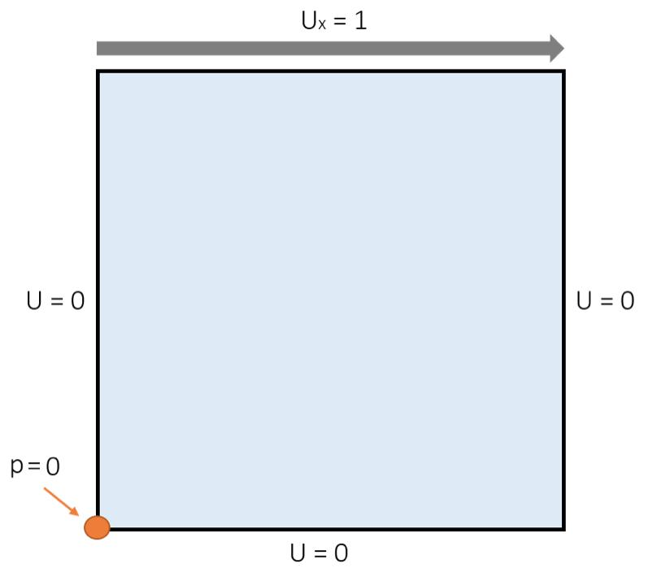

# 2D CFD Solver

A project that simulates incompressible flow in a
two-dimensional lid-driven cavity. The top wall moves to the right, while the
other walls stay still. The program advances the flow in time, prints solver
progress, and writes the final cell values to a CSV file.

The project is intended to make the main steps of a pressure-projection CFD
solver easier to follow:

1. Predict intermediate velocities from the momentum equations.
2. Solve a pressure-correction Poisson equation.
3. Correct the velocities using the pressure correction.
4. Check how close the corrected flow is to mass conservation.



## What the simulation currently runs

The default settings in `src/main.cpp` are:

| Setting | Value |
|---|---:|
| Grid | 20 x 20 cells |
| Domain | 1 x 1 |
| Fluid density, `rho` | 1 |
| Kinematic viscosity, `nu` | 0.01 |
| Top-wall speed | 1 |
| Time step, `dt` | 0.001 |
| Number of time steps | 1000 |
| Pressure update tolerance | 1e-6 |
| Maximum pressure iterations per step | 5000 |

For these values, the Reynolds number is

```text
Re = U_lid * Lx / nu = 100
```

The values can be changed near the start of `main()` in `src/main.cpp`.

## Solver architecture and equations

### Governing equations

For a constant-density, incompressible Newtonian fluid, the equations are:

```text
Continuity:  div(u) = 0

Momentum:   du/dt + (u . grad)u = -(1/rho) grad(p) + nu laplacian(u)
```

Here, the velocity vector is `u = (u, v)`, `p` is pressure, `rho` is density,
and `nu` is kinematic viscosity.

### 1. Momentum predictor

The solver first computes intermediate velocities `u*` and `v*` using an
explicit Euler time step. In component form:

```text
u* = u^n + dt * [
       -(u * du/dx + v * du/dy)
       -(1/rho) * dp/dx
       + nu * laplacian(u)
     ]

v* = v^n + dt * [
       -(u * dv/dx + v * dv/dy)
       -(1/rho) * dp/dy
       + nu * laplacian(v)
     ]
```

The intermediate velocity includes the momentum effects but is generally not
divergence-free yet. The implementation is in `include/MomentumSolver.h`.

### 2. Grid-based numerical operators



The domain is a uniform Cartesian grid. `include/Grid.h` calculates the cell
widths and area:

```text
dx = Lx / Nx
dy = Ly / Ny
cell area = dx * dy
```

`include/Field.h` stores `u`, `v`, and `p` in flat arrays. Each array includes
one ghost-cell layer around the physical grid.

The derivatives used by the solver are centered differences. For a quantity
`q` at cell `(i,j)`:

```text
dq/dx at (i,j) ~= (q[i+1,j] - q[i-1,j]) / (2*dx)
dq/dy at (i,j) ~= (q[i,j+1] - q[i,j-1]) / (2*dy)

laplacian(q) ~= (q[i+1,j] - 2*q[i,j] + q[i-1,j]) / dx^2
              + (q[i,j+1] - 2*q[i,j] + q[i,j-1]) / dy^2
```

These are the numerical operators currently implemented in
`include/Operators.h`.

In a finite-volume method, the same conservation laws are instead integrated
over a cell. For example, the incompressible mass balance is written as a sum
of face fluxes:

```text
sum over cell faces f of [ (u_f . n_f) * A_f ] = 0
```

Here, `A_f` is a face area and `n_f` is its outward unit normal. A scalar
convection or diffusion operator is likewise assembled from fluxes through
the cell faces:

```text
Convection of q:  sum_f [ (u_f . n_f) * A_f * q_f ]
Diffusion of q:   sum_f [ Gamma_f * A_f * (q_N - q_P) / d_PN ]
```

`q_f` is the value at a face, `Gamma_f` is a diffusion coefficient, and
`d_PN` is the distance between neighboring cell centers. These face-flux
equations describe the usual FVM approach; they are included here to explain
the method, not to claim that the current code evaluates them.



**Discretization note:** Finite Volume Methods (FVM) are often described by
integrating conservation equations over each cell and balancing fluxes across
its faces. This project introduces those governing equations, but its current
transient solver evaluates centered differences from neighboring cell values.
It does not yet calculate conservative face-flux sums, and its main flow
fields are not stored on a staggered grid. Therefore, the current time
integration is best described as a finite-difference pressure-projection
solver, rather than a fully conservative FVM implementation.

### 3. Pressure Poisson solver

The pressure correction `p'` is chosen to remove the divergence of the
intermediate velocity:

```text
laplacian(p') = (rho / dt) * div(u*)
```

The code uses the five-point Laplacian and updates `p'` with Gauss-Seidel
iterations. For an interior cell:

```text
p'_new(i,j) =
  [ (p'E + p'W) / dx^2
  + (p'N + p'S) / dy^2
  - (rho/dt) * div(u*) ]
  / [ 2/dx^2 + 2/dy^2 ]
```

This expression is the new pressure-correction value for that cell. Iteration
stops when the largest pressure update is less than the configured tolerance,
or when the maximum iteration count is reached. A reference value is fixed at
one cell (`p'(1,1) = 0`) because pressure is defined up to an additive
constant. Zero-normal-gradient boundary conditions are applied using ghost
cells. See `include/PressureSolver.h`.

### 4. Velocity correction

The predicted velocities are corrected with the pressure-correction
gradients:

```text
u^(n+1) = u* - (dt/rho) * dp'/dx
v^(n+1) = v* - (dt/rho) * dp'/dy
```

The physical pressure is updated as:

```text
p^(n+1) = p^n + p'
```

The implementation is in `include/VelocityCorrection.h` and the time loop in
`src/main.cpp`.

### 5. Mass conservation check

For an incompressible flow, the velocity divergence should be zero:

```text
div(u) = du/dx + dv/dy = 0
```

The program calculates the maximum absolute divergence over the grid before
and after velocity correction and reports both values. This is a numerical
check of mass conservation; the discrete result may not be exactly zero.

### Boundary conditions

The simulation is a lid-driven cavity:

- The top wall moves with speed `U_lid` in the horizontal direction.
- The left, right, and bottom walls are stationary.
- Velocity boundary values are applied with ghost cells in
  `include/BoundaryConditions.h`.
- Pressure and pressure-correction values use zero-normal-gradient boundary
  conditions.



## Build and run

The repository contains the solver's source code, not a ready-to-run Windows
executable. After cloning, build it on your computer with CMake and a C++17
compiler.

### 1. Clone the repository

```sh
git clone https://github.com/razzaqmohammed22/2D_Incompressible_Solver_Development.git
cd 2D_Incompressible_Solver_Development
```

Run the remaining commands from this project directory (the one containing
`CMakeLists.txt`).

### Requirements

- CMake 3.16 or newer.
- A C++17 compiler.
- On Windows, Visual Studio 2022 with the **Desktop development with C++**
  workload (MSVC and the Windows SDK), and CMake available in PowerShell.
- On Linux, a C++ compiler, CMake, and Make or Ninja.
- On macOS, Xcode Command Line Tools and CMake.

### Windows: Visual Studio 2022

Install Visual Studio 2022 with the **Desktop development with C++** workload
and install CMake. During CMake setup, enable the option to add CMake to
`PATH`. Open a new PowerShell window, move to the cloned project directory,
and check that CMake is available:

```powershell
cmake --version
```

Then configure and build:

```powershell
cmake -S . -B build -G "Visual Studio 17 2022" -A x64
cmake --build build --config Release
```

Run the solver from the project directory:

```powershell
.\build\Release\2D_Incompressible_Solver_Development.exe
```

If PowerShell says `cmake` is not recognized, CMake is either not installed or
not on `PATH`. Install CMake and add it to `PATH`, then open a new PowerShell
window. Alternatively, Visual Studio's bundled CMake can be used by setting
`$cmake` to its actual installation path and replacing `cmake` with `& $cmake`
in the configure and build commands. For a typical Visual Studio 2022
Community installation:

```powershell
$cmake = "$env:ProgramFiles\Microsoft Visual Studio\2022\Community\Common7\IDE\CommonExtensions\Microsoft\CMake\CMake\bin\cmake.exe"
& $cmake --version
& $cmake -S . -B build -G "Visual Studio 17 2022" -A x64
& $cmake --build build --config Release
```

If Visual Studio is installed as Professional or Enterprise, replace
`Community` in that path with the installed edition.

### Linux or macOS

With CMake and a C++17 compiler installed, configure and build from the cloned
project directory. The CMake executable target is named `CFD_Solver`. On
Linux and macOS, the built executable normally has no file extension:

```sh
cmake -S . -B build
cmake --build build
```

For the default single-configuration generators (such as Unix Makefiles or
Ninja), run:

```sh
./build/2D_Incompressible_Solver_Development
```

If you explicitly configure a multi-configuration generator such as Xcode,
specify the configuration when building and include it in the executable
path:

```sh
cmake --build build --config Release
./build/Release/2D_Incompressible_Solver_Development
```

The solver writes or replaces `results.csv` in the current working directory.
Run it from the project directory if you want the CSV saved alongside
`CMakeLists.txt`. It prints progress every 100 time steps and the final maximum
divergence.


## Results and plots

The solver writes `results.csv` with one row per physical cell and these
columns:

```text
x,y,u,v,pressure,velocity_magnitude
```

To create plots from that CSV, install Python and the visualization
dependencies:

```powershell
py -m pip install numpy pandas matplotlib
py visualize.py
```

On Linux or macOS, use `python3` instead of `py`. Run the script from the
project directory after running the solver. It saves velocity-magnitude,
velocity-vector, and pressure-contour plots as PNG files and opens the plots
for viewing.

## Project layout

```text
.
├── CMakeLists.txt
├── include/
│   ├── BoundaryConditions.h
│   ├── Field.h
│   ├── Grid.h
│   ├── MomentumSolver.h
│   ├── Operators.h
│   ├── PressureSolver.h
│   └── VelocityCorrection.h
├── readme_images/
│   ├── finite_volume_cell.png
│   ├── lid_driven_cavity.png
│   ├── numerical_stencil.png
│   ├── solver_workflow.png
│   └── transient_time_step.png
├── src/
│   └── main.cpp
└── visualize.py
```
